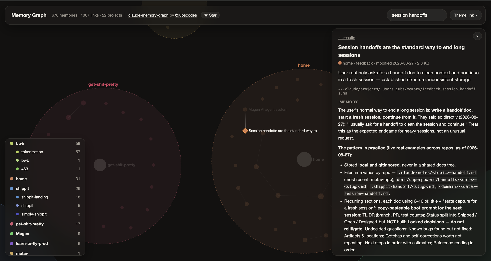

# claude-memory-graph

A [Claude Code](https://claude.com/claude-code) skill that turns your memories into an interactive graph. Every memory in `~/.claude/projects/*/memory/` becomes a node. Nodes cluster by project, projects group into workspaces, and `[[links]]` between memories become edges.

The output is one self-contained HTML file. It needs no server, makes no network calls and has no dependencies, so you can open it from anywhere.



## Install

```bash
git clone https://github.com/jubscodes/claude-memory-graph ~/.claude/skills/claude-memory-graph
```

Then ask Claude: *"show me my memory graph"*.

## Run it directly

```bash
python3 ~/.claude/skills/claude-memory-graph/build.py ~/claude-memory-graph.html
```

| Option | Default |
|---|---|
| `out` (positional) | `memory-graph.html` |
| `--root` | `$CLAUDE_CONFIG_DIR/projects`, else `~/.claude/projects` |
| `--home` | your home dir (used to shorten project labels) |
| `--no-bodies` | off: memory text is included. Turn it on to keep only names and descriptions, e.g. for a graph you'll share |

Requires Python 3.8+, standard library only. It runs on macOS, Linux and Windows. On Windows, use `python` or `py` instead of `python3`, with the path `%USERPROFILE%\.claude\skills\claude-memory-graph\build.py`.

## What you see

- **Workspaces** are dashed regions. `~/Projects/acme`, `~/Projects/acme-api` and `~/Projects/acme-web` all group under `acme`.
- **Projects** are dark hubs, with their memories orbiting them.
- **Shape** shows the memory type: ● project, ◆ feedback, ■ reference, ▲ user.
- **Size** grows with the number of links.
- **Search** opens a side list of matching memories, grouped by workspace. Click a result to jump to it.
- **Reader:** click a memory to read its full text, lightly formatted. `[[links]]` inside it jump to the linked memory.
- **Themes:** Auto, Paper, Ink, Blueprint, Neon, Print, Claude, Cursor and Cyber (a green-phosphor terminal), chosen from the theme menu. Claude and Cursor are palettes inspired by those apps, not official themes.
- Hover, click, filter by type, and toggle workspaces from the legend. Alt-click isolates one.

## Privacy

The HTML embeds each memory's name, description and full text (use `--no-bodies` to leave the text out). Treat it like the memories themselves. Check what's in it before you share it, and don't commit generated graphs. The `.gitignore` here excludes them.

## Development

```bash
python3 -I test_build.py
```

`build.py` parses memories and writes the data into `template.html`. The template holds the canvas renderer and force layout in plain JavaScript.

## Author

Made by Julia Hoffmann Buratto ([@jubscodes](https://github.com/jubscodes)).

If the graph showed you something about your memories, ⭐ [star the repo](https://github.com/jubscodes/claude-memory-graph). It helps other Claude Code users find it.

## License

MIT
